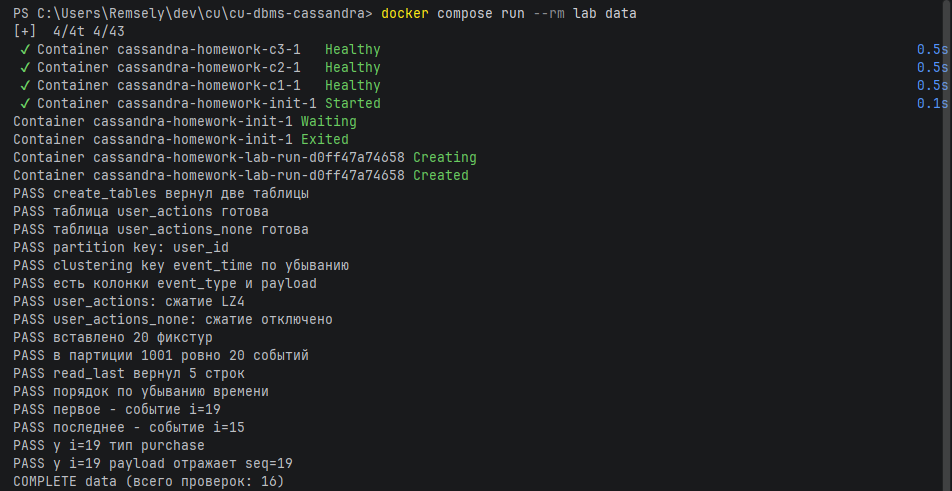
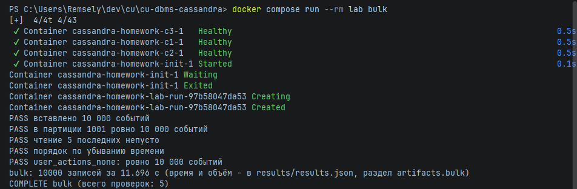
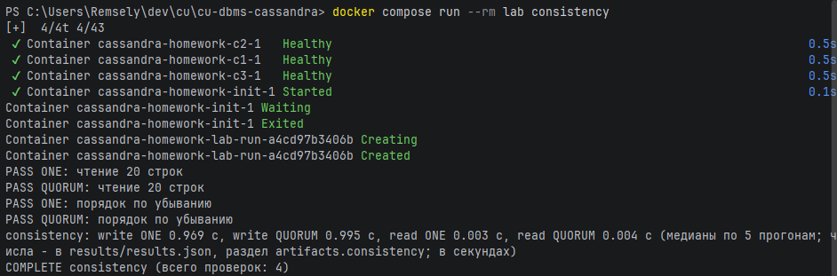
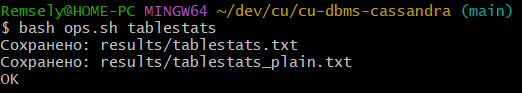
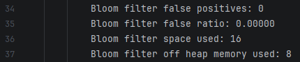
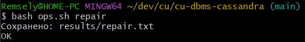
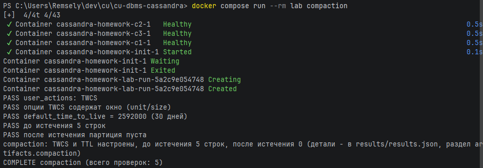
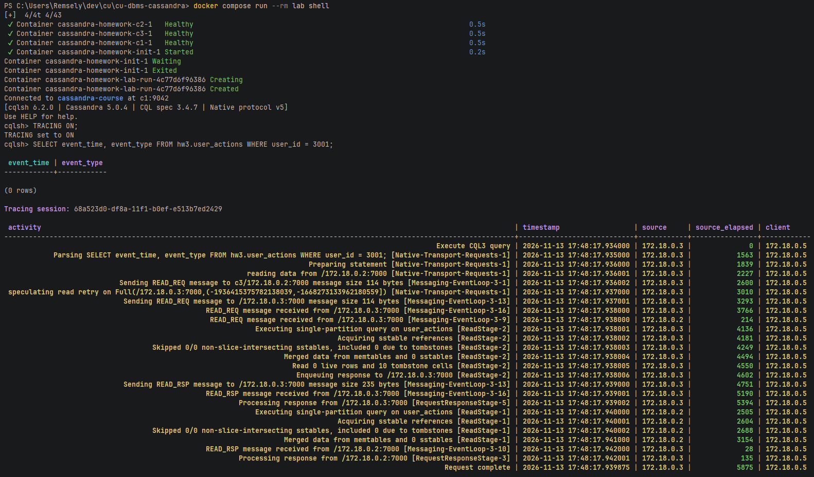
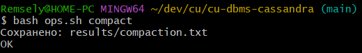
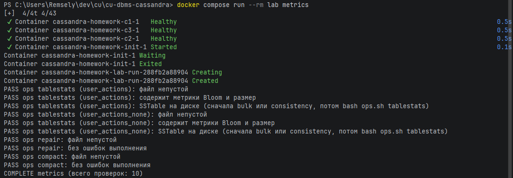

# DEMO

## 2. Таблицы и модель данных

```
docker compose run --rm lab data
```



## 3. Вставка и чтение

```
docker compose run --rm lab bulk
```



## 4. Консистентность

```
docker compose run --rm lab consistency
```



## 5. Сжатие

```
bash ops.sh tablestats
```



## 6. Bloom-фильтр



## 7. Repair

```
bash ops.sh repair
```



## 8. TTL и компакция

```
docker compose run --rm lab compaction
```



```
docker compose run --rm lab shell
```

```
TRACING ON;
SELECT event_time, event_type FROM hw3.user_actions WHERE user_id = 3001;
```



```
bash ops.sh compact
```



## 9. Результаты

```
docker compose run --rm lab metrics
```


